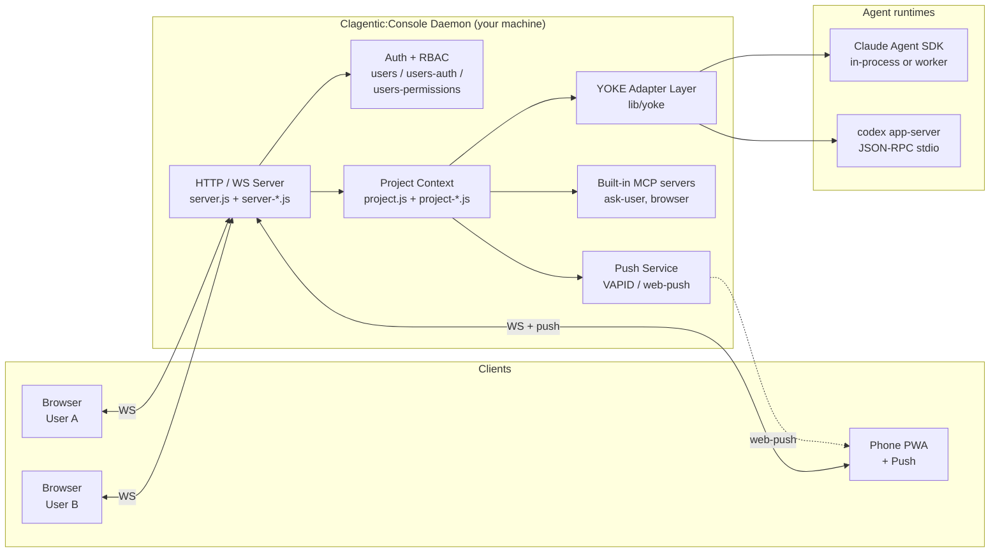
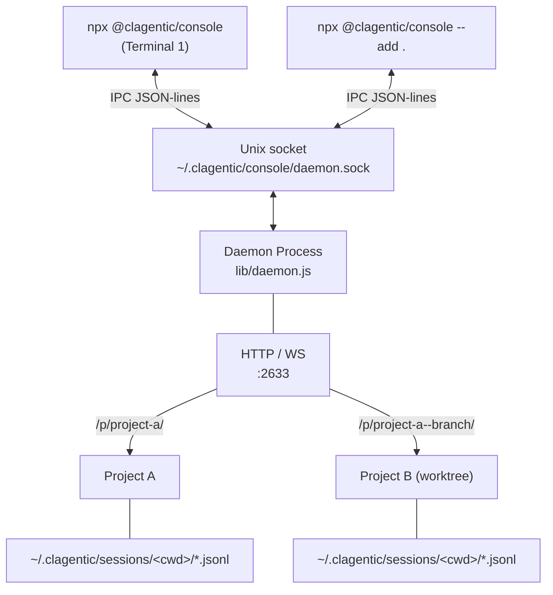
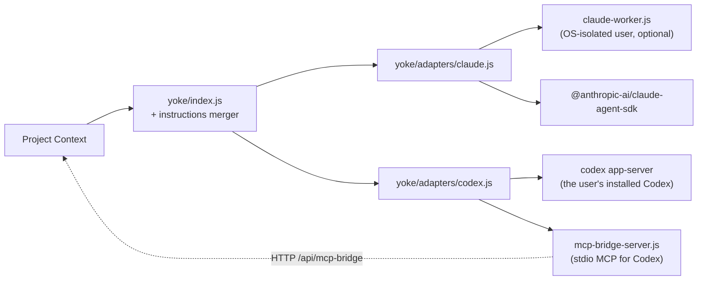
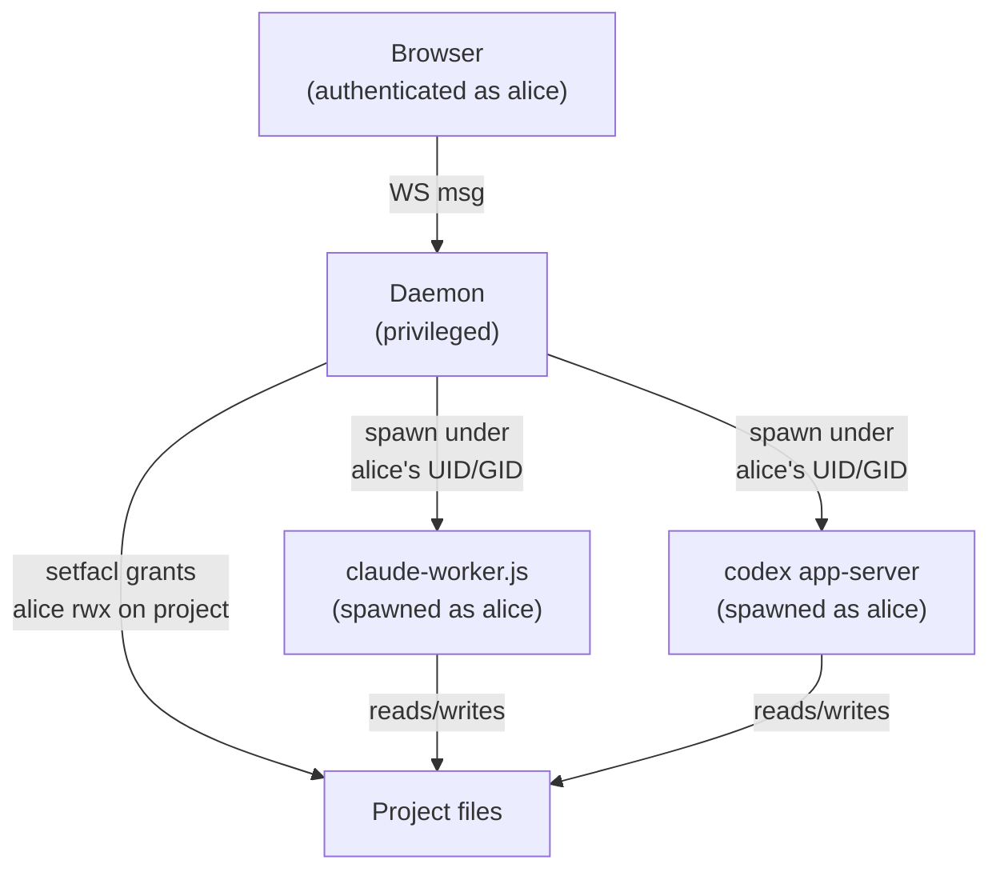
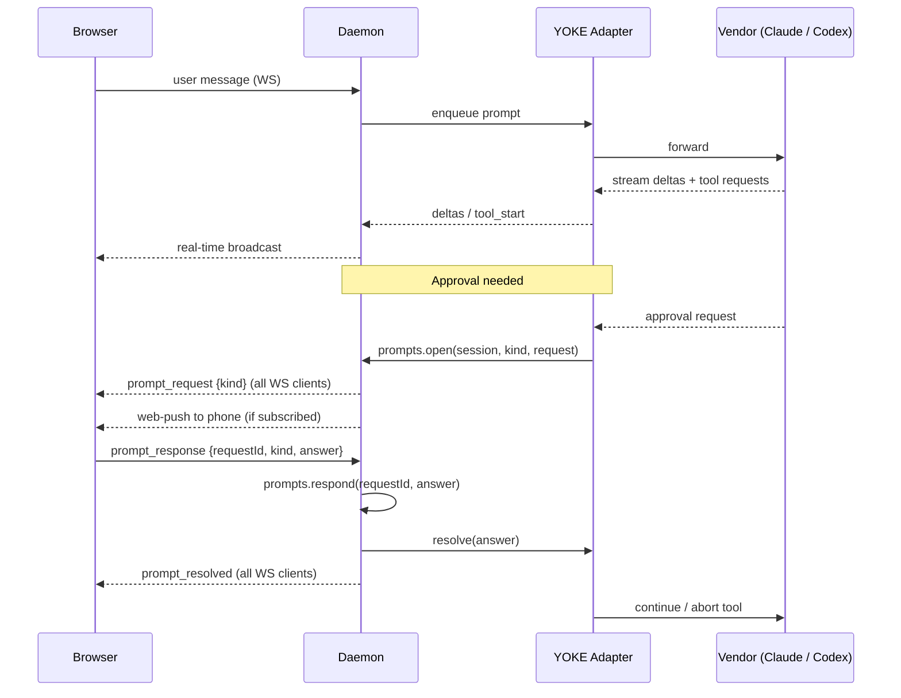

# Architecture

Clagentic:Console is not a CLI wrapper. It is a self-hosted daemon that drives **Claude Code** (via the [Claude Agent SDK](https://www.npmjs.com/package/@anthropic-ai/claude-agent-sdk)) and **Codex** (via the `codex app-server` JSON-RPC protocol) through a vendor-agnostic adapter layer (**YOKE**), and serves a multi-user web workspace over HTTP/WS.

Everything runs on your machine. Sessions and settings live as plain JSONL/Markdown on disk. No cloud relay, no proprietary database.

## System Overview



## CLI ↔ Daemon

Clagentic:Console decouples the CLI from the long-running server. The CLI starts (or attaches to) a detached daemon over a Unix domain socket.



The daemon is spawned with `detached: true` and survives CLI exit. Multiple CLI instances share one daemon. IPC commands include `add_project`, `remove_project`, `set_pin`, `set_keep_awake`, `shutdown`, `get_status`, `get_activity_diagnostics`, `open_session`, `send_session_input`.

### Supervised start: `clagentic-console daemon`

Under systemd the daemon is not detached. `clagentic-console daemon` (`bin/cli.js`) runs `lib/daemon.js` in the foreground, in the same process, so the PID systemd tracks (`Type=simple`) is the daemon. It refuses to start from an `npm link` install (an unscoped `clagentic-console` symlink beside the scoped global install) and exits 78 (EX_CONFIG), which the unit lists in `RestartPreventExitStatus`.

`scripts/postinstall.js` installs the unit only for a global install (`npm_config_global` / `npm_config_location=global`); a local `npm ci` or `npm install` in a checkout does nothing to the host. It fills the shipped template `deploy/clagentic-console.service` with the absolute path of the global bin (`ExecStart=<prefix>/bin/clagentic-console daemon`) and removes the old hand-placed `/usr/local/bin/clagentic-daemon.sh` only if it is byte-for-byte the known legacy wrapper.

### Host identifiers

Everything console puts on a host is scoped to the product (see `CLAUDE.md` and the clagentic CLI Naming Standard): `CLAGENTIC_CONSOLE_*` env vars (the un-scoped names are read through `lib/env-compat.js` for one release, with a warning), `~/.clagentic/console/` data (including `recent-projects.json`, copied once from the old home-directory dotfile), the `clagentic-console-daemon` Windows pipe, and the `clagentic-console-offline-v<version>` service-worker cache.

New projects go to the directory chosen by `lib/projects-dir.js`: `projectsDir` from `daemon.json` if set; else `~/clagentic-console-projects` if it exists; else a legacy directory (`~/clagentic-projects`, `~/clay-projects`) used in place; else `~/clagentic-console-projects`. In os-users mode: `/var/lib/clagentic-console/projects` if it exists, else a legacy `/var/clagentic/projects` used in place, else the former. Registered project paths, worktrees and session history are absolute-path keyed, so a project directory is never moved, renamed, copied or symlinked.

### Agent-readable diagnostics over IPC

Some server-side diagnostic probes (e.g. the activity-source divergence
counter that sizes the `session.isProcessing` vs. registry-derived-active
redesign) are recorded server-side but were historically only reachable
through a live WebSocket client (`process_stats`) — unreachable by a
read-only crew agent holding only `Bash`+`Read`, no browser, no WS client,
no devtools.

The daemon.sock IPC channel above is already reachable by such an agent (it
is a plain Unix socket, no browser or WS client required), and is gated by
filesystem permissions rather than any per-command auth check: `CONFIG_DIR`
(containing `daemon.sock`) is created `chmod 0700` (`ensureConfigDir`, `lib/config.js`),
so only the daemon's own OS user can connect at all. A read-only diagnostics
command added to this channel inherits that gate for free — it does not
copy the auth gap `process_stats`'s WS handler has (`lib/project-sessions.js:668-709`,
tracked separately), since it is a different transport with its own,
stricter gate.

**The exact command a Bash-only agent runs** to read the activity-divergence
probe from a running daemon:

```
clagentic-console --activity-diagnostics
```

This prints JSON to stdout:

```json
{
  "activeLiveCount": 0,
  "activityDivergenceCount": 0,
  "activityDivergenceRecentSamples": []
}
```

Samples carry no session-identifying field (`ts`, `rawIsProcessing`,
`derivedIsActive`, `hasQueryInstance` only) — the same shape
`process_stats` already carries, unchanged by adding this second retrieval
path. See `lib/sdk-bridge.js`'s `buildActivityDiagnosticsResponse()` (the
shared, unit-tested function both retrieval paths can call) and
`lib/daemon.js`'s `get_activity_diagnostics` IPC case.

### Opening sessions and sending input from outside the browser

Any caller (an operator script, an agent, a person at a shell) can open a session or direct input into one, whatever its kind: a vanilla Claude or Codex session or one running a named agent. This is injection into a human-to-LLM console session, not agent-to-agent messaging. There is one implementation, `lib/session-input.js`, behind two transports:

- **The CLI**, over the daemon IPC socket (`open_session` and `send_session_input` cases in `lib/daemon.js`):

  ```
  clagentic-console open-session --project <slug> --prompt <text|-> [--vendor <id>] [--agent <name>] [--visibility shared|private] [--initiator <kind>] [--context-note <text>]
  clagentic-console send-input   --project <slug> --session <id> --prompt <text|-> [--initiator <kind>] [--context-note <text>]
  ```

  `--prompt -` reads the prompt from stdin. Both print the result as JSON and exit 0 when the request was acted on, 1 otherwise.
- **The file drop** (`lib/project-external-trigger.js`, `external-triggers/` in the console config directory) for writers without the CLI. v1 and v2 files keep their shape; v2 with `sessionId` is send-input, anything else is open-session, and `vendor`, `agentName`, `sessionVisibility` and `initiator` are optional fields. The outcome is written into the file's record in `processed/` under `result`.

**Send.** The input becomes the session's next turn. A session with a running query takes it into that query (`delivered`). A session whose runtime has ended (the idle reaper, a daemon restart) is resumed on its own vendor and agent, from the stored meta record, by the same resume the browser's `resume_session` uses (`lib/session-resume.js`), and the input starts its next turn (`resumed-and-delivered`). A resume for injected input does not move any connected client off the session it is viewing. `--session` takes the console session id (`consoleSessionId` in an open result) or the vendor-assigned id. Only the console's own session store is asked about a session that is not in memory: an id it does not hold is `not-found`, and the file moves to `processed/` with that result and is never retried. Sessions started outside the console (a vendor CLI run by hand) are not addressable. A store record that cannot be read, or whose history has any blank, malformed or non-object line (the error names the session and the line; each line must parse to a JSON object, and the single newline ending the file is the only blank allowed) is an `error` instead, and the session is not resumed. A session id is checked against the safe-id allowlist (`lib/session-id.js`: letters, digits, `_` and `-`) before it reaches any file path, on the browser's `resume_session` and on injected input alike, and every path built from an id is checked to stay inside its directory. An unsafe id (`../x`, an absolute path) is `refused` on injected input and an error on the browser path; it is never read as absent.

**Open.** `vendor` (any registered vendor), `agentName` (a named agent as the picker offers it) and `sessionVisibility` go to `createSession` as the browser's `new_session` passes them; absent means the default vendor, no agent, shared. The call returns as soon as the first turn has started. The result carries `consoleSessionId` (the console's own id, always present), `sessionId` (the vendor-assigned id, `null` until the vendor has assigned one), `localId`, `vendor` and `agent`; either id is what `send-input --session` takes. If the first turn fails to start, the session the call created is removed and the result is an `error` with `retryable: false`; the caller opens again if it wants to.

**Initiator.** Injected input is never a human turn. Accepted values are `trigger`, `scheduled`, `scheduled-now` and `loop`; absent is `trigger`. `human` and any unknown value are refused by name. Human turns come only from the authenticated browser path.

**Results** (`result` in the JSON): `delivered`, `resumed-and-delivered`, `opened`, `not-found`, `refused` (with `reason` naming the vendor, agent, visibility, initiator or project) and `error` (delivery was attempted and failed). `delivered`, `resumed-and-delivered` and `opened` are reported only after the session's query has actually started; a send whose start rejects or throws is an `error` with `retryable: true`, and the session's processing flag is cleared. A file-drop trigger with a retryable `error` stays in the triggers directory (retried after a restart, expiring by TTL); one with `retryable: false` (a failed open, a damaged history) is archived with that result. A handled trigger is archived with one rename into `processed/` after the request is handled, and its result is then written into the processed record. File-drop delivery is therefore at-least-once across a daemon crash: a crash between delivery and the rename leaves the trigger pending, and it is dispatched again on restart. A crash (or write failure) between the rename and the result write leaves a processed record without a `result`; nothing retries it. The prompt of an opened session is recorded in its history once, only after the query has started; a rejected start leaves no entry. A `refused` result with `retryable: true` means the daemon is shedding new work under memory pressure; a file-drop trigger stays in place and is retried until it expires.

**Security is unchanged.** Callers must be the daemon's own OS user: the file drop needs write access to the config directory and `daemon.sock` is reachable only through it (`chmod 0700`). Per-user routing in multi-user mode remains future work.

## YOKE Adapter Layer

YOKE (Yoke Overrides Known Engines) is the vendor abstraction. Each adapter implements the same contract (`init`, `createQuery`, etc.), so `project.js` never has to know which agent runtime is driving a session.



**Vendor registry.** Each adapter registers one descriptor with `yoke/registry.js` (from `yoke/adapters/<name>-vendor.js`, so listing the agents never loads the adapter): its id, display name and icon, install probe and executable names, `installHint`, `loginCommand`, whether it supports per-user OS isolation (`osUsersSupported`), whether every entry point needs `runtimeEnv` (`needsRuntimeEnv`; true for Codex), the environment variables it owns for its endpoint and credentials (`ownedEnvNames` for exact names, `ownedEnvPrefixes` for whole namespaces: Claude owns every `AWS_*`, `GOOGLE_*`, `GCLOUD_*`, `CLOUDSDK_*`, `CLOUD_ML_*`, `ANTHROPIC_VERTEX_*` and `ANTHROPIC_FOUNDRY_*` name, so a variable no list mentions is still owned; `yoke/env-ownership.js` is the one matcher), the project instruction files it reads itself, its interrupt wording, its auth check, its factory and its declared capabilities. Everything that needs to know which agents exist reads the registry: `createAdapter`, `createAdapters` and lazy creation, install detection (`yoke/install-probe.js`, whose executable-name allowlist is the registered names and which refuses any other name with `YOKE_DISALLOWED_BINARY`), auth checks, the default agent of a project (lowest `priority` among the available ones), the login command in every "not logged in" message and notification, and the agent picker. An unregistered vendor is `YOKE_UNKNOWN_VENDOR`. Adding an agent is registering a descriptor; the daemon sends the registry to every browser as a `vendor_registry` message (on connect, after warmup and after `recheck_vendors`), and the picker, the login launcher and every capability-gated control render from it.

**Capability ledger.** `yoke/interface.js` defines the capability keys once (`CAPABILITIES`): `effort`, `permissionModes`, `fork`, `rewind`, `rollback`, `sessionList`, `sessionRename`, `sessionArchive`, `contextCompacting`, `mcpPanel`, `backgroundTasks`, `steering`, `agentInjection`, `executionPolicy` and the rest. Each descriptor declares all of them; the declaration is exposed for every registered agent whether or not it is the project default, so a Claude session in a Codex-default project is gated on Claude's capabilities. `resolveCapabilities(yoke, connection, sessionAdvertised)` (`yoke/capabilities.js`) starts from the declaration, lays a connection's `capabilityOverrides` over it (an override may widen or narrow; a key outside the ledger is an error) and finally narrows it by what the live session advertises, which can never widen. A control is enabled or disabled from these keys, never from an agent's name: an unsupported control stays visible and disabled with the one-line reason defined beside the key. Every session-facing decision (the agent-injection guard, binding a session to an agent, which permission modes a session accepts) reads the RESOLVED set for the session's agent through one accessor, `capabilitiesFor` in `lib/session-capabilities.js`, over `sm.capabilitiesByVendor`; a declaration is never read directly, and a vendor with nothing recorded has no capabilities. The resolved set of every registered agent is recorded when the bridge is created, narrowed by the live session's advertisement whenever an agent's `init()` runs (warmup, a session's first query, `get_vendor_models`, lazy creation), and the registry is re-sent to the clients when it changes. How the console drives an adapter is a different thing and is not negotiated: `perProjectRuntime` (which adapters a project creates for itself and shuts down with it) and `activityTokens` (which agents hold explicit activity tokens for their tool and thinking blocks) are traits, booleans on the descriptor read with `registry.traitOf`; they are never resolved, narrowed or overridden. `agentInjection` stays a capability: which sessions may take a named agent identity.

**Cross-vendor instruction merging.** On every `createQuery`, YOKE scans the project for instruction files (`CLAUDE.md`, `AGENTS.md`, `.cursorrules`, …), drops the ones the current vendor reads natively, and merges the rest into `systemPrompt`. The result: a Codex session sees `CLAUDE.md` content, a Claude session sees `AGENTS.md` content. Switching vendors does not break project context.

**Codex specifics.** Codex talks to the daemon via JSON-RPC 2.0 over its app-server's stdin/stdout (`yoke/codex-app-server.js`). Approval events, skill injection, and MCP tool calls travel as RPC messages. Built-in tools that Codex needs (ask-user, browser) are exposed through a stdio MCP bridge (`yoke/mcp-bridge-server.js`) that proxies to the daemon over HTTP.

For deeper Codex integration patterns and gotchas, see [CODEX-INTEGRATION.md](./CODEX-INTEGRATION.md).

### The Codex the console runs

The console ships no Codex. Codex is a prerequisite the user installs (`npm install -g @openai/codex`), and the console runs that one, so the models and protocol it offers are the installed version's.

**Resolution** (`yoke/codex-binary.js`) mirrors how a Claude binary is found, minus a bundled fallback. In order, the first one found is used and is then validated by running it with `--version`:

1. `CLAGENTIC_CONSOLE_CODEX_PATH`, an absolute path an administrator sets in the daemon's environment. A value that is not absolute, names no executable file, or cannot report a version is not skipped: the agent is disabled with a message that names the variable and the path (`CODEX_OVERRIDE_INVALID`).
2. `codex` on `PATH`.
3. Common install locations: `~/.npm-global/bin`, `~/.local/bin`, `~/.volta/bin`, `~/.bun/bin`, `~/bin`, `/usr/local/bin`, `/usr/bin`, `/opt/homebrew/bin`.

The oldest supported Codex is **0.148.0** (`yoke/codex-version.js`). No Codex, or one below that, leaves the agent disabled in the picker with the reason beside it ("Codex is not installed. Install it with: npm install -g @openai/codex, then use Re-check." or "Codex 0.147.9 is too old; Clagentic: Console needs 0.148.0 or newer"). A usable Codex shows its version beside the name and its path and version in the tooltip. The registry's install probe carries that outcome (`probeInstalled` returns `{installed, detail: {path, version, source, reason}}`, sent to the browser as `installDetail`); resolutions are remembered for 30 seconds and forgotten on `recheck_vendors`. A resolution runs the binary, so it is never repeated per call.

**Version-gated protocol** (`yoke/codex-protocol.js`). The version that is running decides what the console sends; no decision reads an agent's name. The version is read from the binary's own `--version` when it is resolved and cross-checked against the `userAgent` the app-server returns from `initialize` (`<originator>/<version> (...)`; `initialize` has no version field of its own). Both are parsed defensively; when they differ the app-server's wins and the difference is logged, and a running version below the floor refuses the server. One table maps a feature to the version that has it, and an unreadable version is taken to be the floor:

| Feature | From | What the console does |
|---|---|---|
| rewind | not offered | `thread/rollback` was removed in 0.156.0 and is never used. Its replacement, `thread/revert`, takes no expected-state argument, so it cannot be made safe against a turn appended while it runs; the console does not call it either. The capabilities `rewind` and `rollback` are false for Codex, the controls are shown disabled with "Rewind is not available for Codex sessions yet", and `rollbackThread` rejects without sending the server anything. Fork is unaffected. |
| project trust | not set by the console | From Codex 0.150.0 an untrusted project supplies no project `AGENTS.md`. The console never sets project trust, for any version: Codex applies the user's own trust decisions from their Codex configuration, exactly as the Codex CLI does. See "Project trust" below. |
| `turnTrigger` | 0.151.0 | A free-text field on `turn/start`. Codex treats a turn as automated only for the value `automation_heartbeat_scheduled`; any other value, or none, is a user turn. A typed turn omits the field; every other initiator (`scheduled`, `scheduled-now`, `loop`, `trigger`) sends that value. Codex has no finer distinction, so which kind of automation started a turn is not carried to it. |
| plan tool | 0.152.0 | `tools.update_plan.enabled=true` is passed in the app-server config, or Codex does not produce plans. |

The wire-level fields above have no control to gate, so they are gated by the version table where they are sent. A descriptor may give its own one-line reason for a capability it lacks (`capabilityReasons`, sent to the browser per agent), which the control shows in place of the ledger's general one; Codex uses it for the two rewind keys.

**Approval policy.** The default is `on-request` (`lib/codex-defaults.js`). `on-failure` is an alias of `on-request` in current Codex releases and not a variant of its own, so a saved `on-failure` and any value passed on is normalized to what it means (`normalizeApprovalPolicy`); an unrecognized value asks rather than running unattended. The picker offers `never` ("Auto") and `on-request` ("Ask"). The legacy profiles table is not read or written.

**Skills.** One list serves both agents. `sdk-skill-discovery.js` discovers from `.claude/skills` and `.agents/skills` in the user's home and in the project (a project skill beats the user's of the same name; within a level an agent's own directory beats the other's). Codex takes a skill as an input item carrying its `SKILL.md` path, so `$name` in a Codex turn is matched against the whole list; the Codex app-server is also told where Claude's skills are (`skills/list` extra roots). A skill that exists only in the other agent's directory is listed, but Claude Code does not invoke a skill from `.agents/skills` on its own.

**Project trust.** The console never sets it. Trusting a project lets Codex load that project's own configuration, which can name programs to run (an MCP server command, for example) as the daemon user, so opening a repository in the console must not imply that trust. On Codex 0.150.0 and later an untrusted project supplies no project `AGENTS.md`; the user trusts a project through Codex itself, and Codex applies that decision from the user's Codex configuration exactly as the Codex CLI does. There is no console option for it.

**Mid-session controls.** The Claude SDK's `Query` has no `setEffort`; the Claude adapter changes a running session's effort through `applyFlagSettings({effortLevel})` (`yoke/adapters/effort-control.js`, shared by the in-process handle and the worker). A QueryHandle's `setEffort` settles on the real outcome and rejects when the change did not take effect, so the bridge announces a new effort only after the query has taken it and shows the operator the failure otherwise; Codex reads its effort on the next turn. Which permission modes a session accepts is a capability: the Claude adapter lists `permissionModes` (including `dontAsk` and `auto`, which are Claude Code modes) in its declaration, the mode picker (`public/modules/mode-options.js`) offers those two only when the session's vendor declares them, and `set_permission_mode` refuses them for a session whose vendor does not. A vendor whose capabilities are not known is treated as declaring nothing.

**Per-turn origin.** Who started a turn is a property of that turn, never of the session: one session can take a typed turn, a scheduled one and a typed one again. Each place that starts a turn names its initiator from one vocabulary (`INITIATORS` in `lib/turn-initiator.js`) and passes it down with the turn: `startQuery(session, text, images, linuxUser, initiator)` and `pushMessage(session, text, images, initiator)` in `sdk-bridge.js`, and `QueryHandle.pushMessage(text, images, initiator)` in YOKE. The entry points are the WebSocket `message` frame and an answered prompt (`human`), the scheduled-message timer (`scheduled`), `send_scheduled_now` (`scheduled-now`), every loop iteration and loop judge (`loop`) and an external trigger (`trigger`). A turn whose entry point names none is delivered with no origin, which a vendor that distinguishes the cases reads as unattributed. The console keeps no session-level record of it, and nothing is declared per adapter: the adapter maps the initiator to the vendor's own provenance field and the console writes no record of its own, so any tool that reads a vendor's session files sees the same facts it sees for that vendor's own CLI.

The Claude adapter follows the Claude Agent SDK's `SDKMessageOrigin` contract. Every pushed user message is stamped: `human` is `{kind: "human"}`; every other turn uses the one automated kind the CLI accepts from a host, `{kind: "task-notification", subkind: "scheduled-trigger", fireReason}`, and is told apart by `fireReason`: `scheduled`, `manual` (`scheduled-now`), `loop`, or `trigger`. The CLI persists a host-supplied origin only when it is `human`, or `scheduled-trigger` in a process started with `CLAUDE_CODE_HOST_SCHEDULED_RUN=1`; it silently drops every other kind (for example `auto-continuation`), leaving the turn with no origin. Every turn except a typed one also carries `client_composed: true`, so the CLI delivers its text as written, with no `@path` expansion and no slash-command dispatch. The environment of every Claude process (in process, in a per-user worker, and the warmup) is the process's own, then the Settings variables, then `CLAUDE_AGENT_SDK_CLIENT_APP=clagentic-console/<package version>` and `CLAUDE_CODE_HOST_SCHEDULED_RUN=1`, the only condition under which the CLI honors a host-declared `scheduled-trigger` origin. It is set on every process, whatever turn starts it: the environment is fixed when a process starts, while turns of any initiator reach a live process (a typed turn starts it and a trigger or scheduled turn is pushed in later, within the idle window or mid-turn), and messages buffered between turns are replayed into whichever process starts next. Read from the installed CLI (2.1.296), the variable has two effects: a host-declared `scheduled-trigger` origin is honored only with it, and an oversized-attachment diagnostic event is switched off. A `human` origin is checked before the variable is consulted and is kept either way, so a typed turn in the same process still persists `human`.

The Codex adapter identifies the product in the app-server `initialize` handshake (`clientInfo.name` is `clagentic-console`, `version` the package version); that value is what Codex records as the rollout's originator. Codex carries one bit of per-turn provenance, `turnTrigger` (from Codex 0.151.0): the adapter reads the initiator from the same `pushMessage` argument the Claude adapter does and maps typed turns to no trigger and every other initiator to the automation trigger, for a Codex that has the field (see "The Codex the console runs"). On an older Codex, and for the finer distinction between kinds of automation, a Codex turn is delivered without one.

## Agent-runtime environment

Settings hold two environment texts of `KEY=VALUE` lines (the pages write each row as `export KEY=VALUE`): the **shared** text (`sharedEnv` on the daemon config, administrators only) and one per **project** (`envrc` on the project's record). `daemon-env-settings.js` stores them; `server.js` hands its callbacks to every project, which is how the Settings pages reach them.

Every agent-runtime start takes its environment from one builder, `lib/runtime-env.js`: the runtime's own environment first, then the shared text, then the project text (a later layer wins). The SDK bridge reads both texts fresh at each start and passes the result down as `runtimeEnv` on the YOKE call, so a change reaches the next runtime without a restart of the daemon.

**Who gets the project text.** The shared text, which only administrators write, goes to every runtime. A project's text is written by the project owner, so in multi-user mode it goes only to sessions owned by the project owner (`projectEnvApplies` in `runtime-env.js`); another user's session in the same project gets the shared text only. A list of refused names cannot make the other rule safe, because the next variable (an API base URL, a tool-options variable, a config directory) would be missing from it. A runtime that serves no one session, such as a model-list warmup, takes the project text in single-user mode only. A project with no owner, and a session with no owner, get none in multi-user mode. A worktree has no settings of its own: it uses its parent project's text and owner, and the Settings page of a worktree reads and writes the parent's. Reading or changing a project's text in multi-user mode is limited to the owner and administrators, and a change of owner removes the text, so the new owner does not inherit what the previous one wrote. Single-user mode applies the text to every session.

| Start | Where the variables are applied |
|---|---|
| Claude query in process (and its rewind query, model-list warmup) | `claude.js` sets the SDK's `options.env` to the complete environment: `process.env` with the variables laid over it |
| Claude query for an OS user | The daemon sends only the variables in `query_start`; `claude-worker.js` lays them over the worker's own (OS user's, `build-user-env.js`) environment and hands the SDK the complete result |
| Codex app-server | `codex.js` keeps one app-server per effective environment (keyed by a digest of it, never logged) and starts each with the complete environment (`CodexAppServer` `opts.env`); an operation runs on the server for its own environment, starting one if there is none (see "Codex servers" below) |

The Claude Agent SDK's `options.env` REPLACES the subprocess environment (it is not merged with `process.env`), so nothing hands it only the additions; `PATH` and `HOME` survive because the base is always the whole environment. Values are never logged (a warning names the variable and the settings layer), never sent to the browser beyond what the Settings lists show, and never written to session files.

**Protected variables.** Settings may not set or override `HOME`, `PATH`, `USER`, `LOGNAME`, `SHELL`, `TMPDIR`, the loader (`LD_*`, `DYLD_*`), `NODE_OPTIONS`, `NODE_PATH`, the console's own variables (`CLAGENTIC_*`, `CLAY_*`), and every variable that makes a shell, interpreter or tool run code on its own (`BASH_ENV`, `PROMPT_COMMAND`, `PYTHONSTARTUP`, `GIT_SSH_COMMAND`, `GIT_CONFIG_*`, `CLAUDE_CODE_PROCESS_WRAPPER`, ...). This is defense in depth for the host's integrity; what keeps one user's variables from another user's session is the ownership rule above. The list is `lib/runtime-env-keys.js`, grouped by class and compared without regard to case. It is enforced twice: a save that sets one is refused with a message naming the variable and line, and the builder drops one that is already in a saved text (and in the overlay a worker receives), with one warning per variable and layer.

**Applying a change.** A change applies to sessions started after it is saved (the Settings pages say so). A runtime that is running, or idle and still attached to its session, keeps the environment it started with and is never ended because Settings changed; the settings are read again when a runtime starts: a new session, or a session whose runtime the idle reaper ended, on its next message.

**Codex servers.** A Codex app-server's environment is fixed when its process starts, so one process cannot serve two environments. The adapter keeps one instance per environment, keyed by a digest of it (never logged), and everything that depends on the environment lives on the instance: the process and client, its model list and default model, its reference count and its init. The adapter itself holds only the working directory, the project slug, its default init options, the map of instances and the shutdown flags. One lookup resolves the instance for init, queries, model lists, and fork. The bridge always passes `runtimeEnv` on a Codex call, the overlay or `null` for no settings (the daemon's own environment); a call without it is refused, so no operation is ever served by a server of another environment. A thread operation (fork) runs on the instance for the environment the caller states, started again if the idle reclaim ended it, and never on an instance picked by thread id; when that instance cannot operate on the thread the operation fails. A rewind of a Codex session is refused before any instance is looked up (see the protocol table above) and leaves the local history as it was. The model list the project shows everyone is read only in the environment no session adds to (the warmup and the vendor switch), so one user's endpoint models are not shown to others; a session's own model list and default model come from its instance. A server nothing is using is ended by the idle reclaim: the daemon's timer (`idle-adapter-reaper.js`) asks each project context to `reclaimIdleAdapters`, which calls `shutdownIfIdle` on its adapters.

## Session Titles

The console never asks a model for a session title: no adapter, and not the bridge, has a title-generation method, and no title query is started for any vendor. A title query would be a saved agent session of its own (a transcript in the vendor's store, and the user's session hooks run for it).

The title shown for a session is, in order:

1. **The operator's rename** (`titleManuallySet`), always.
2. **The vendor CLI's own title.** The Claude Code CLI titles each session itself and appends `{"type":"ai-title","aiTitle":"...","sessionId":"..."}` to the session's transcript (`<claude dir>/projects/<encoded cwd>/<cli session id>.jsonl`); the last such record wins. The Claude Agent SDK's message stream has no message for it (`sdk.d.ts` declares none, and `SDKSessionInfo.summary` mixes it with the custom title and the first prompt), so the console reads the transcript: `lib/cli-transcript-title.js` scans the file backwards from its end for the newest record naming this session, and `lib/session-ai-title.js` copies it onto the console session. This runs when each turn completes (`sdk-message-processor.js`), so a title the CLI writes during a turn is shown by the end of that turn, and a newer one replaces the older. The transcript is the session owner's own (`<owner home>/.claude` in os-users mode, else `CLAUDE_CONFIG_DIR` or the daemon user's `~/.claude`). It is never written.
3. **The first-line title** (`deriveProvisionalTitle`, or an injected session's context note) while the transcript has no `ai-title` record yet: a new session, a session resumed from a transcript older than the CLI's titling, or a vendor with no CLI title.

The result is stored in the session's one `title` field, so every surface that shows a title (the session picker, prompt cards, banners and push, the restart interrupt list, the CLI listings) reads it from there and none has its own source. Codex has no title of its own to use: the app-server's `thread.name` is only set by an explicit `thread/name/set` call and is absent otherwise, so a Codex session shows the first-line title until the operator renames it.

## Multi-User and OS-Level Isolation

Clagentic:Console supports two modes:

- **Single-user.** PIN auth, all sessions run as the daemon's UID.
- **Multi-user.** Each user has an account, optional invites, OTP, RBAC permissions, and (on Linux) an OS-level Linux account.

When OS-level isolation is enabled on Linux:



`os-users.js` is the shared utility. It validates Linux usernames, resolves UID/GID via `getent passwd`, runs filesystem operations as the target user via a helper subprocess, and grants ACL access via `setfacl`. The kernel enforces isolation: one user's agent cannot read another user's project files even if the application code has a bug.

User provisioning lives in `daemon.js` (`provisionLinuxUser`, `grantProjectAccess`). All worker spawns route through `os-users.resolveOsUserInfo`.

**Codex in os-users mode is disabled.** The Codex app-server is not yet started per OS user, and one started by the daemon would run as the daemon's user in a user's place. So an agent whose descriptor says `osUsersSupported: false` is refused in this mode, with the reason "Codex is not yet isolated per OS user": the install state reports it not installed with that reason (the picker shows it disabled; `installDetail.reason`), `createAdapters` and `lazyCreateAdapter` make no adapter for it, `createAdapter` and `createCodexAdapter` throw (`YOKE_OS_USERS_UNSUPPORTED`, `CODEX_OS_USERS_UNSUPPORTED`), and a session bound to it is stopped with the reason when it tries to start a query. No Codex app-server is ever started. Claude is unaffected. Running Codex per OS user is a separate piece of work.

## Access Control and Input Trust

Authorization is not opt-in per handler. One resolver (`lib/project-access.js`) answers "who is this, and may they use that project?" for every check, and an answer that cannot be given is a refusal: no lookup wired, an unknown slug, a lookup that throws, or a mode that cannot be read all deny, administrators included. A project record with no `visibility` is private; only `"public"` opens a project to everyone. A worktree has no record of its own and takes its parent's (`daemon-projects.js` `getProjectAccessRecord`).

**Authentication precedes, and is separate from, principal resolution.** `principalFor(user, { authenticated })` (and `canAccess`, `isAdmin`, `filterProjectList`, `canReadSession`, which take the same last argument) yields the implicit owner for a missing user only when the caller proved the login: `isRequestAuthed(req)` for an HTTP route, the WebSocket upgrade's cookie/ticket/login check (recorded on the connection as `_clagenticAuthenticated` and read back with `authOf(ws)`), or the local MCP bridge. Without the proof a missing user is nobody in every mode, so a route that forgets its login check refuses instead of serving the owner's data. A route that resolves a principal passes the proof it has; it never assumes one.

**Given the proof, "no user" is decided by the daemon's mode (`users.isMultiUser()`), never by absence alone.** In single-user mode a connection that got past the login gate carries no user record (`_clagenticUser === null`): the connection is the implicit owner, with admin rights and access to every project. In multi-user mode no user means unauthenticated and is refused. Every gate, filter and route asks the resolver instead of dereferencing the user, so a missing user never throws. A project context built without a resolver (unit harnesses) is single-user.

| Where | What it does |
|---|---|
| WebSocket upgrade, HTTP project routes, root redirect | `projectAccess.canAccess(userId, slug, proof)`; the local MCP bridge POST is the one request that carries no login. Every outcome of an upgrade answers or destroys the socket, including an unexpected error |
| `lib/project-message-gate.js`, called first by `handleMessage` | re-checks the connection's user against this project on every message; a `targetSlug` is authorized, resolved to a project that exists, and removed before any handler sees the message; a frame that is not a JSON object is dropped |
| Project lists (`projects_updated`, `info`, hub schedules) | filtered per client: `broadcastAll` turns a `projects_updated` into one filtered message per client, so no call site filters for itself |
| `GET /api/palette/search` | `appHandler` has no login check ahead of it, so the route proves authentication itself (`isRequestAuthed(req)`) before a principal is resolved; no proof is a 401 in every mode |
| Palette results, session rename, delete and search, file history | the session's own owner/visibility rule (`canReadSession`) is applied before anything is read |

Global settings (the global CLAUDE.md, shared environment variables) are administrator-only. What those environment variables do once saved is under "Agent-runtime environment" below. The per-project environment messages act on the project the message arrived in, never on a slug the message carries.

**File policy** (`lib/project-file-scope.js`) is shared by the WebSocket `fs_*` handlers, `GET /api/file` and the watchers. The `fileBrowser` permission applies to every `fs_*` message except `fs_unwatch`. A path is resolved once, by one function that refuses non-strings, null bytes and anything outside the project after symlink resolution. In os-users mode a user with no resolved OS identity is refused; there is no fallback to a read as the daemon user. Watches (`project-file-watch.js`) belong to the connection that opened them: a change is read as that user and sent to that connection only, and a watch ends when its connection does.

Git history, diff and file-at-commit (`lib/project-git.js`) take only hex revisions, so a client value can never be read as a git option, and only project-relative paths. A repository's own config can name programs (textconv, `diff.external`, `core.fsmonitor`, hooks), so read-only git runs, in os-users mode, as the uid that owns the repository (the stat of the nearest `.git` found by walking up from the project directory, so a project in a repository subdirectory works), never as the viewer; viewer authorization is the access gate's job. Outside os-users mode git runs as the daemon. No `safe.directory` override is passed, a repository whose owner cannot be determined is refused, and every call passes `-c core.fsmonitor=false -c core.hooksPath=/dev/null -c diff.external=` and, for `diff`/`show`/`log`, `--no-ext-diff --no-textconv`; only committed blobs are compared.

**WebSocket origin** (`lib/ws-origin.js`): a request with no `Origin` header (CLI, relay, MCP bridge) is accepted, since the login still applies. Otherwise the origin's host and port must equal the request's `Host` header (or `X-Forwarded-Host` when `trustedProxy` is set), or the origin must be in `allowedOrigins` in `daemon.json` (for example `["https://console.example.com", "chrome-extension://<id>"]`). Scheme is compared only where the daemon knows it: it terminates TLS itself, or `trustedProxy` reports `X-Forwarded-Proto`. Extension origins are refused unless listed.

**Names that come from outside** (vendor names, tab ids, MCP server names and call ids, request ids, file names shown in the file tree) never index a plain object: tables keyed by them are prototype-less maps, vendor names are checked against the vendors the daemon can build, and a result for an extension or MCP call is accepted only from the socket the call was sent to.

## Operator Prompts

Every tool call goes through a vendor-neutral approval gate, and every other point where an agent waits on the operator (plan approval, AskUserQuestion, an MCP elicitation) uses the same machinery.



### One owner for every prompt's lifecycle

`lib/prompt-registry.js` is the only code that changes operator-prompt state, for every kind: tool permission, plan approval (ExitPlanMode), AskUserQuestion, MCP elicitation (Claude's `onElicitation` and Codex's `mcpServer/elicitation/request`), and the browser-extension commands the daemon sends a client. A kind (`lib/prompt-kinds/`) is a small adapter: its payload fields, how a response is parsed and validated against the request it answers (an unknown decision fails closed; an AskUserQuestion answer keeps only the questions asked, option labels the question offers and bounded text; elicitation content keeps only the schema's fields, each of its declared type and within its constraints, and an acceptance missing a required field, of a schema outside the supported subset (below), or approving a URL that is not http(s) is refused as `invalid`, which settles nothing and re-offers the prompt to the responder), what the vendor's callback receives for an answer, and what it receives when the prompt ends unanswered (deny for tool calls, reject for elicitation, null for extension commands). No kind keeps its own map or cleanup code. What an answer is for the two kinds the operator types into is defined once and shared with the card: `ask-user-codec.js` (chosen labels, options sharing a label as one choice, "Other" text, the tool's text-keyed answers with questions that share their text keeping every answer) and `elicitation-codec.js` (the requested JSON Schema's fields by type, required or optional, a form control's text read as a typed value, empty as absent, defaults shown only when they fit, URL requests). Each, and `own-key.js` (below), has one source: the ES module the browser is served from `lib/public/modules/prompt-kinds/`. The server loads those same files through `lib/prompt-kinds/codecs.js`, once, when the registry is first required: with `require()` where Node can load an ES module that way, else with `import()`, which the daemon awaits (`prompt-registry.js` `ready()`) before it accepts a connection. A codec that fails to load stops the daemon, and one read before it has loaded throws. `test/shared-codecs.test.js` checks that the server's modules are the browser's (same file, same module instance) and that no server copy exists. A callback whose abort signal has already fired is answered as cancelled at once and never becomes a prompt, so nothing is broadcast or recorded for it. Codex command, file-change and MCP approvals arrive through the same `canUseTool` callback as Claude's.

A prompt is `pending` until exactly one transition settles it — an answer (`resolved`) or the end of the scope that owns it (`cancelled`, with a reason). Every path that ends a prompt calls a registry transition: the WS answer (`project-prompt-responses.js`), the HTTP push answer (`project-http.js`), the parent turn's `result` (`sdk-message-processor.js`), query end (`sdk-bridge.js`'s `processQueryStream` finally), the abort signal (including an expiry relayed from a worker, and the Codex app-server clearing a request it never got an answer to), a kind's timeout, rewind, context clear, session deletion and daemon shutdown. Settling always calls the vendor's resolver once, dismisses the notification banner, and records `prompt_resolved` / `prompt_cancel` so every client — live or replaying later — sees the outcome. The session side effects of an answer (a plan decision's permission mode, fresh session or feedback message) are installed with `onResolved()` and run inside `respond()`, so no answer path can settle a prompt and skip them; both answer paths also apply one access rule (`lib/prompt-access.js`). Outside the registry a prompt is visible only as a frozen copy of its request (`lookup()`), never as its record or resolver.

Each journalled prompt leaves one `[prompt-registry]` journal line when it opens and one when it settles, so "was a prompt pending" and "how did it end" are answerable from the journal: project, session, request id, kind, tool name and the owning background agent (`task:<id>` or `none`), plus on a settle the decision word, whether a grant was stored, the cancel reason and the source. Never the tool input, the question, the answer or any prompt text. The source (`lib/prompt-source.js`) says who or what settled the prompt: `ws` (the connection's `clientId`, a per-connection label, and the user id), `push` (the action and user), `timeout`, or `cancel` (the reason). The registry logs it and the `prompt_resolved` event records the same source in session history; an answer whose caller names none is logged `source=unspecified` and its event carries none. Every value in these lines passes `lib/log-field.js`, which keeps a title, tool name or id that came from outside from ending a line or splitting a field.

The same discipline covers the rest of a session's lifecycle: `lib/session-input.js` logs one `[session-input]` line per `open_session` and `send_session_input` request, whichever caller made it (IPC verb or file drop), with the project, console session and result, and the reason for a refusal; a browser `resume_session` failure logs the session and reason; the idle reaper logs the sessions it skipped for an open prompt on each sweep; and every write of `session.lastActivityAt` goes through `lib/activity-clock.js`, which names the source and logs it at debug level (`CLAGENTIC_CONSOLE_DEBUG`). Console session ids repeat across projects, so lines about a query carry the project slug.

Work that must run when the process exits is registered with `lib/exit-flush.js`, which installs a single `process` `exit` listener however many project session managers register, so startup with many projects adds no `MaxListenersExceededWarning`.

Ownership decides scope. A top-level prompt ends with its turn or its query. A prompt whose tool call belongs to a tracked sub-agent (a running Task, or one that reported completion while that prompt was still open) survives the parent's turn and query boundaries, so the operator can still answer a backgrounded sub-agent after its parent finished; it ends only on an answer, its own abort, or the session or daemon ending. The abort is the vendor's word that the callback is gone: the Claude SDK aborts every callback still waiting when it closes a query, the worker relay does the same when the worker's query ends or the worker cancels a callback, and the Codex adapter when the app-server clears a request or the query ends. The registry never decides on its own that a sub-agent is dead. "Allow for Session" grants are written and consulted only through the registry, keyed by `permissionGrantKey()`, flushed to the session file immediately, and granted only from the authenticated in-app card: the HTTP push route answers tool approvals with allow or deny only.

#### An open prompt is not idleness

The idle reaper (`startIdleReaper`, `lib/sdk-bridge.js`, 30-minute `IDLE_TIMEOUT_MS`) never ends a session with an open prompt of its own or a background agent's (`prompts.pendingCount(session) > 0`): an agent blocked on a prompt emits no stream events, so its silence is the operator's to break. Memory pressure is `lib/memory-shed.js`'s job, not the idle timer's. When the reaper or memory shedding does end a session that still has registered background agents, both call `announceLiveAgentReclaim` (`lib/session-reclaim.js`): the agents are named (from the Task's description or subagent type, kept in `session.taskLabels` while the Task is tracked), the session gets the durable `pendingAutoResume` marker with its reason (`idle_reap` or `memory_pressure_reclaim`), a Diagnostics-panel entry goes to the project's clients and an inline error is recorded in the session. A daemon shutdown or restart (IPC `shutdown` and `restart`, the web-UI restart, the update handoff, SIGTERM and SIGINT, an uncaught exception) all end in `shutdownProjects` -> `relay.destroyAll()` -> each project's `destroy()`, which kills every claude child. Before `destroy()` aborts a session whose query is running and still tracks background agents, it calls `announceShutdownReclaim`, which goes through `announceLiveAgentReclaim` with reason `daemon_restart` and `deferNotice`: the process is exiting and nobody is connected, so nothing is sent; `pendingAutoResume`, the reason and the agent names (`pendingAutoResumeAgents`, at most 8) are written to the session file synchronously. A session with no tracked agent, or no running query, is untouched. At the next startup `surfaceRestartReclaims` (called when the project context is created) records the inline notice naming the agents in each such session, drops the persisted names so a further restart does not repeat it, and keeps them in memory for the Diagnostics-panel entry that `restartDiagnostics` sends to each client that connects (only for sessions that client may see) until the session is opened. The marker itself stays until the operator's first reconnect to the session consumes it. Reap, shed and shutdown share the one announcer; there is no second path.

A prompt raised by a background agent says so: its card carries "Requested by background agent ..." and its notification and push title start with the agent's name.

#### Whose prompt it is

A banner and a push reach every connected client whatever project it is viewing, and a tool request alone does not say whose it is. So every session prompt of every kind carries `label: {project, session, agent}`, built once by the registry when the prompt opens (`lib/prompt-label.js`; the project name is read through the session manager's `getProjectName`, `agent` is the Task description of the owning background agent and is empty for the session's own prompts). The card draws it above its text (`prompts.js`), the notification carries it in `meta.label` and the banner draws it (`app-notifications.js`), and every prompt push (tool permission, AskUserQuestion, elicitation) starts its body with `Project: ... | Session: ... | Agent: ...`. Each part is one bounded line, because a session title and a Task description are authored outside the console. The label rides `prompt_request`, the `prompt_pending` snapshot and history replay; a recorded request from before labels has none and is drawn as it was.

#### What Allow for Session grants

An Allow-for-session answer grants what the call asked for and no more. `lib/grant-keys.js` builds one key per call, and the same key is what is stored in `session.allowedTools` and what a later call is looked up by: `Bash=<line>`, exactly that command line and nothing wider (a grant from `find . -print` does not cover `find . '-delete'`, `find . -print -delete` or `rm`). Deriving a prefix from the command text missed shell semantics at two successive heads (a quoted find action flag, substitutions, wrappers), so the prefix keys and their derivation are removed rather than patched; a line too long to keep has no key, and its card offers no Allow for session. A persisted `Bash:<anything>` key is dropped by `sanitizeAllowedTools` on load; a legacy whole-tool `Bash` stays honoured, shown as whole-tool and revocable. The rule: a session grant never covers a call the operator did not see. File tools (`Write`, `Edit`, `MultiEdit`, `NotebookEdit` and the Codex file-change approval) never produce a session grant: they have no key, no stored value and no filesystem read. Their cards offer Allow (this call) and Deny only, and an Allow-for-session answer that still arrives from an older client is answered as allow-once and stores nothing. Scoping a file grant to a path (lexically, then by realpath) opened a new hole at three consecutive reviews, so the feature is removed rather than patched. A persisted `Write:<path>` key in any form, and any non-boolean value, is dropped by `sanitizeAllowedTools` on load. `Skill:<name>`; otherwise the tool name (MCP tools already carry server and tool). `SCOPED_TOOLS` is the one table of tools with scoped keys, and a legacy whole-tool grant (`Bash`, `Write`, `Edit`, `MultiEdit`, `NotebookEdit`, `Skill`) is honoured for every tool in it and listed as whole-tool. A non-file call with no narrow key (a line too long to keep) has none: its card offers no Allow for session and the server refuses that answer as `invalid`, the same way it refuses one to a `suppressAlwaysAllowRule` ask. The prompt carries `grantScope`, the sentence saying what the click grants ("Allow only this exact command in this session"), computed from the same key; the card and the banner show it before the click.

The session meta record is read back from a 4 KiB chunk, so the grant map is bounded (`MAX_GRANTS`, `MAX_KEY_LENGTH`, a byte budget); a grant that does not fit is not stored and the call is allowed this once. A grant map written before grants were scoped may hold a whole-tool key (`Bash`, `Write`, ...): it stays readable and in force until revoked, and is listed as a whole-tool grant.

The operator lists and revokes a session's grants from the session's context menu ("Permission grants"): `list_session_grants` is answered with `session_grants`, `revoke_session_grant {key}` removes the key through the registry (`revokeGrant`), flushes the session file at once and sends every client viewing the session the new list. The next tool call the grant covered prompts. Both messages apply the answering rule of `lib/prompt-access.js`; a refused revoke is answered to the asker as `session_grants` with an `error` and no grants, and the card keeps its rows and re-enables Revoke (the button is disabled only while a send is in flight, and a row is removed only when the server's list no longer holds the grant). There is no second grant store: the registry, `permissionGrantKey` and the session meta record are the only places grants live.

#### Presentation hints on a tool-permission ask

The Claude Agent SDK may attach three hints to an ask, and the console holds to each wherever it carries, shows or answers one. They travel from the SDK's `canUseTool` options into the prompt record on both Claude paths: in process, and over the worker IPC (`lib/yoke/adapters/permission-relay.js` builds the message in the worker and the options in the daemon, so neither side can drop a field the other carries). Codex approvals arrive through the same callback with no hints and are unchanged.

- `suppressAlwaysAllowRule`: the ask must not offer a persistent choice. The permission kind refuses an `allow_always` answer to it as `invalid` on every response path (the card and its older aliases, the notification banner), which settles nothing, writes no grant and re-offers the prompt to the responder; the HTTP push route answers allow or deny only. Leaving the button off the card and the banner is the presentation of that rule, not its enforcement.
- `defaultToNo`: the ask must not open on an approve choice. The card and the banner lead with the decline choice, mark it the default and mark no approve choice; there is no single-key approve shortcut.
- `matchedAskRule`: a rule the user wrote forced the prompt, so the user's stated intent is a human prompt. The sdk bridge's host-side auto-approvals (full auto, an autonomous loop, the read-only whitelist, an earlier Allow for session) never answer such an ask. They do not answer an ask marked `suppressAlwaysAllowRule` or `defaultToNo` with a standing approval either, since a standing approval grants more than the ask itself. The rule (bounded text, whatever shape it arrives in) is recorded on the prompt record and on the `prompt_resolved` event, and the card shows it.

The hints are request fields, so the recorded `prompt_request`, the `prompt_pending` snapshot sent on connect and the history pages all carry them, and a replayed card renders the same restrictions. The banner reads them from the notification's `meta`.

A browser-extension command (kind `extension`) is answered by the socket it was sent to and no other: `extension_result` is checked against that socket, and a `prompt_response` naming an extension command is no operator answer on any path.

The registry's state lives where readers already looked for it: one pending map per store (`session.pendingPermissions` for tool and plan approvals, `session.pendingAskUser`, `session.pendingElicitations`), `session.subagentToolOwners`, `session.activeTaskToolIds` (Task tracking), and the session manager's `permissionRequestIndex`. A requestId, message type, decision, cancel reason or kind is whatever a client sent, so every map keyed by one, on the server and in the client, is read through `own-key.js` (`ownValue()` / `hasOwnKey()`: own properties only, strings only) and written through `putOwn()`. A name every object inherits (`constructor`, `__proto__`, `toString`, ...) is no prompt and no table entry: on every answer path it gets the not-found reply (`test/prompt-hostile-request-id.test.js`).

#### Supported elicitation schemas

A form-mode elicitation is drawn and answered only when its requested schema is inside the subset MCP elicitation defines, which `elicitation-codec.js` (`schemaProblem()`) checks before anything else:

- the schema is `{type: "object", properties, required}`, optionally with `$schema`, `title`, `description` and a boolean `additionalProperties`; no schema at all asks for no fields;
- every property is flat and one of: a string (`minLength`, `maxLength`, `format` of `email`, `uri`, `date` or `date-time`), a number or integer (`minimum`, `maximum`), a boolean, or a string enum (`enum` of strings, `enumNames` naming each value); each may carry `title`, `description` and `default`.

Every keyword in the subset is enforced on the card and again on the server: lengths count characters, bounds are inclusive, formats are checked, `enumNames` label the choices, and a default is shown only when it is itself a valid answer. Nothing outside the subset is supported: nested objects, arrays, `pattern`, `oneOf` / `anyOf` / `const`, other formats, numeric enums, untyped properties and any other keyword. A schema that uses any of them is refused whole: the card draws no form, says why, and offers only Deny, and the server answers an acceptance of it as `invalid`, so no half-checked answer reaches the MCP server.

### Clients render server state, not replay order

On connect, session switch and every history page, the server sends the authoritative state of every prompt it renders: a replayed item that opens a prompt (`prompt_request`, the older `permission_request` / `elicitation_request`, or the AskUserQuestion `tool_executing` that draws its card) carries `promptState` (`pending`, `resolved` with its decision, answers or action, or `cancelled` with a reason), and still-pending prompts are re-sent as `prompt_pending`. One client module (`lib/public/modules/prompts.js`) applies every prompt message of every kind and recorded shape; `prompt-state.js` mirrors the state per `requestId` with final terminal states, so a card is a pure function of the state regardless of whether a page delivered the request before or after its outcome. Every kind shares one card shell (`prompt-card.js`: an answer moves the card to "sending" until the server confirms) and supplies only its body and answer controls (`prompt-kinds/`). The notification banner reads the same state and answers through the same state machine (`prompt-banner.js` over `prompt-card.js`: sending until the server settles the prompt, answerable again on an ack timeout or a dropped connection): the registry dismisses it on every transition, and prompt notifications are not restored after a daemon restart because no resolver survives one.

`test/prompt-invariants.test.js` generates interleavings of every event above, for every kind, across several clients and daemon restarts, and checks the lifecycle invariants after each step. `test/prompt-kind-roundtrip.test.js` checks, for generated requests (question sets with shared labels and shared question text; schemas of every field type, required or optional, with fitting and unfitting defaults; URL requests) and generated answers of every kind, that what the operator chose on the card survives answering, settling, JSON serialization, replay and rendering unchanged; a new kind fails it until it supplies its own round-trip spec. `CLAGENTIC_CONSOLE_PROMPT_HARNESS_LIB` points its wire-level checks at another checkout's `lib/`; `npm run test:prompt-history` runs its named regression scenarios against the commits before and after each past fix, and fails unless each fails before its fix and passes after it and on the checkout.

`project-notifications.js` formats the alarm and may also fire push.

## Session Storage

Sessions live at `~/.clagentic/sessions/{encoded-cwd}/{cliSessionId}.jsonl`, one JSONL line per event:

```
{"type":"meta","localId":1,"cliSessionId":"...","title":"...","createdAt":...,"vendor":"claude"}
{"type":"user_message","text":"..."}
{"type":"delta","text":"..."}
{"type":"tool_start","id":"...","name":"..."}
...
```

Append-only. At most the last line is lost on a crash. The daemon replays all session files on restart.

Settings are JSON in `~/.clagentic/`. User-configured MCP servers live in `~/.clagentic/mcp.json`.

## Multi-Project Routing

```
/                    → Dashboard (auto-redirect if only one project)
/p/{slug}/           → Project UI
/p/{slug}/ws         → Project WebSocket
/p/{slug}/api/...    → Project HTTP (push subscribe, file access, image, …)
/p/{parent}--{branch}/ → Worktree (auto-detected child of parent project)
```

Slugs are auto-generated from the directory name. Duplicates get `-2`, `-3`, etc. Worktrees are scanned by the parent slug (`daemon-projects.js`) and registered with a `parent--branch` slug pattern.

## Built-in MCP Servers

| Server | File | Provides |
|---|---|---|
| `browser` | `browser-mcp-server.js` | Open / navigate / click / screenshot / extract via the user's connected browser |

User-defined MCP servers from `~/.clagentic/mcp.json` are loaded on top.

For Codex sessions, built-in MCPs are exposed through a stdio bridge (`yoke/mcp-bridge-server.js`), which proxies tool list / call back to the daemon over HTTP at `/api/mcp-bridge`.

For deeper MCP details, see [MCP-IMPLEMENTATION.md](./MCP-IMPLEMENTATION.md).

## Push Notifications

`push.js` generates a VAPID key pair on first run (`~/.clagentic/vapid.json`, mode 600) and uses `web-push` for delivery. Subscriptions are stored per-user.

Push fires on:
- Permission requests
- Task completion / errors
- @mentions of the user (only when the user has no live WS connection)

The service worker (`lib/public/sw.js`) handles incoming pushes and routes the user back to the right session on tap.

## Key Design Decisions

| Decision | Rationale |
|---|---|
| Unix socket IPC | CLI ↔ daemon without burning an extra TCP port |
| Detached daemon | Server outlives the CLI; sessions keep running after `exit` |
| JSONL session storage | Append-only, crash-friendly, `cat`/`grep`-friendly |
| Vendor adapters under YOKE | Adding a new agent runtime is an adapter, not a refactor |
| Cross-vendor instruction merge | Switching Claude ↔ Codex doesn't lose project context |
| Codex via JSON-RPC stdio | Approval events and skills need real-time RPC, not exec mode |
| OS-level isolation (Linux) | Trust the kernel for user separation, not application code |
| Slug-based routing | Many projects, one port, predictable URLs |
| `0.0.0.0` + PIN | LAN access by default; use a tunnel for remote |

## Memory Limits (Linux / systemd)

The shipped `deploy/clagentic-console.service` unit carries percentage-based cgroup limits as a **documentation-only fallback**:

```
MemoryHigh=70%   # soft ceiling — kernel begins reclaiming early
MemoryMax=85%    # hard ceiling — triggers per-service OOM (systemd kills and restarts)
OOMPolicy=kill   # kill all cgroup members on OOM; systemd Restart=always handles the restart
```

**Never trust a systemd `%` memory directive inside a container (lr-c10f6d).** systemd resolves `MemoryHigh=70%` / `MemoryMax=85%` against the cgroup-visible MemTotal at the layer it runs — inside an LXC container that is the **host's** RAM, not the container's. Only userspace (via lxcfs) sees the container-true `/proc/meminfo`. On a 12G container behind a ~28G host, the applied cgroup ceiling silently resolved to `high=19.8G max=24.0G` — a "last line of defense" (OOMPolicy=kill) that could never fire before the kernel's host-level OOM killer wedged the whole box.

### Computed absolute defaults (lr-c10f6d)

Because of the above, the installer never relies on the unit file's `%` lines. On every `npm install -g @clagentic/console` (root required), `scripts/postinstall.js` (via `lib/memory-limits.js`) reads `/proc/meminfo` MemTotal directly in userspace and writes a systemd drop-in at `/etc/systemd/system/clagentic-console.service.d/memory-overrides.conf` with **absolute byte values**:

```
MemoryHigh = floor(60% of MemTotal)
MemoryMax  = floor(75% of MemTotal)
```

This is recomputed and rewritten unconditionally on every postinstall, so it tracks RAM changes without any operator action — reinstalling after a RAM upgrade is sufficient (no manual edit needed, unlike a stale absolute pin).

### Optional daemon.json overrides (lr-de07)

Operators who need to pin explicit byte or percentage values can add `memoryHigh` and/or `memoryMax` to `~/.clagentic/console/daemon.json`. An explicit override always takes precedence over the computed default above.

```json
{
  "memoryHigh": "6G",
  "memoryMax":  "8G"
}
```

Accepted formats: `NNN%` (whole number, 1–100) or `NG` / `NM` / `NK` / bare bytes. Note that a `%` value here resolves through the same systemd `%`-inside-a-container caveat as the shipped unit file — prefer an absolute value (`NG`/`NM`) for any container deployment.

**If you pinned an absolute override and added RAM:** update `memoryHigh` / `memoryMax` in `daemon.json` and re-run `npm install -g @clagentic/console` as root (or write the drop-in manually and run `systemctl daemon-reload`).

### Startup applied-ceiling sanity check (lr-c10f6d)

On every Linux startup, the daemon compares the *applied* cgroup `memory.max` (read from `/sys/fs/cgroup/system.slice/clagentic-console.service/memory.max`) against `/proc/meminfo` MemTotal. If the applied ceiling is `max` (unset) or `>=` the container's true RAM, the daemon emits a structured stderr WARN (`event: memory_ceiling_inoperative`, captured by journald) and a UI toast diagnostic ("memory ceiling exceeds container RAM — OOM protection inoperative"). This turns a silent miscalibration — the exact failure mode that caused this task — into a visible fault on any future host, even if the drop-in is stale, hand-edited, or was never applied.

### Bounded in-heap session history (lr-2ea2a7)

On-disk JSONL is the single source of truth for full session history. The in-heap `session.history` array is always a bounded TAIL window — for every session, including one that is actively processing (a long-running Ralph/crew loop). Prior to lr-2ea2a7, a session's `isProcessing` state exempted it from LRU eviction (`lib/sessions.js`) with no other cap on its heap history, so a multi-hour loop accumulated its entire event stream in memory — the root cause of repeated daemon OOM incidents.

Every append to `session.history` routes through `recordHistoryEntry()` (`lib/sessions.js`), which enforces `HISTORY_INMEM_MAX` (default 1000 entries) with hysteresis down to `HISTORY_INMEM_TRIM_TO` (default 800): once the heap array exceeds the cap, the oldest entries are trimmed and `session._historyBaseIndex` advances by the trimmed count. Absolute index (`_historyBaseIndex + heapOffset`) remains the wire/UI contract (`history_meta.total/from`, `load_more_history.before`, `messageUUIDs[].historyIndex`) — no wire-format change.

Operators can override the cap via `~/.clagentic/console/daemon.json`:

```json
{
  "historyInMemMax": 2000
}
```

`process_stats` (admin panel) reports per-session `{heapEntries, baseIndex}` and the top 5 sessions by heap footprint for diagnosing memory pressure without a heap snapshot.

**If you pinned an absolute override and added RAM:** update `memoryHigh` / `memoryMax` in `daemon.json` and re-run `npm install -g @clagentic/console` as root (or write the drop-in manually and run `systemctl daemon-reload`). Operators using the default percentage values need not do anything.

### MemoryHigh watermark log (lr-de07)

The daemon polls for MemoryHigh crossings (every 5 s) using either the cgroup v2 `memory.events high` counter (preferred) or process RSS vs. the resolved threshold (fallback). When a crossing is detected, a single structured log event is emitted to stderr (captured by journald):

```
[memory-limits] WARN memory_high_watermark {"event":"memory_high_watermark","source":"cgroup.memory.events","timestamp":"...","highCounter":1}
```

This signal feeds two independent consumers of `onCrossing` (`lib/daemon.js`), both wired to the same watermark crossing:

- **Pressure (lr-6b30, `lib/drain.js`)** — refuses new sessions and new query processes (`lib/new-work-gate.js`, consulted by `new_session` in `lib/project-sessions.js` and `startQuery` in `lib/sdk-bridge.js`) and broadcasts a `memory-pressure` diagnostic. It **never exits the daemon**: the memory belongs to the sessions' own child processes, which a restart cannot free, only kill. Existing sessions keep running and clients stay connected. When the watcher's `onRecovery` sees usage back below the threshold (5% hysteresis), new work is accepted again. `MemoryMax` and the kernel remain the hard backstop.
- **Graceful drain (`lib/drain.js`)** — operator-initiated only (SIGUSR1/SIGUSR2): rejects new WebSocket connections and exits once in-flight sessions complete (or `drainTimeoutMs` forces exit). Memory crossings do not enter this state.
- **In-process shedding (lr-5e70, `lib/memory-shed.js`)** — an immediate attempt to reduce RSS *before* drain's slower shutdown path completes. Runs first, synchronously, inside the same `onCrossing` callback.

### In-process memory shedding (lr-5e70)

`shedMemory()` (`lib/memory-shed.js`) runs a shedding pass across every open project (`relay.forEachProject`, `lib/server.js`):

1. **Retrim every loaded session's history** to `HISTORY_INMEM_TRIM_TO` via `sm.retrimHistory()` — including the actively-viewed and `isProcessing` sessions, which the lr-2ea2a7 bounded-tail cap makes safe to trim unconditionally (disk remains the full source of truth; a later `load_more_history` scroll-up still serves older content from disk).
2. **Force-evict loaded sessions beyond the normal LRU limit** down to a pressure limit (`LRU_HISTORY_LIMIT / 2`) via `sm.forceEvictToLimit()` (`lib/sessions.js`) — more aggressive than the routine one-at-a-time post-load eviction (`_lruEvictIfNeeded`), since a shedding pass may need to unload many sessions at once. Still never evicts the actively-viewed session or an `isProcessing` session — same invariant as the routine LRU path.
3. **Drop rebuildable caches.** Currently: `lib/server-skills.js`'s `skillsCache` (TTL-cached skills.sh proxy responses — any dropped entry just re-fetches on next request). Other module-level caches surveyed during this task (`lib/pages.js` template cache, `lib/daemon-projects.js` worktree registries, `lib/smtp.js` OTP store, `lib/store.js` queues, `lib/user-presence.js` presence store) were left alone: each holds state that is either short-lived by design or not safely re-derivable without a live client round-trip, unlike the skills proxy cache.
4. **Emit a UI diagnostic** (`type: "diagnostic", source: "memory"`) to every project's connected clients — the same session-independent `ctx.send()` delivery path settings-preflight diagnostics already use — with before/after RSS and counts of what was shed, so operators see pressure in the Diagnostics panel, not just journald.
5. **Emit a structured `memory_shed` log event** to stderr (`beforeBytes`, `afterBytes`, `sessionsTrimmed`, `sessionsEvicted`, `cachesDropped`).
6. **Rate-limited to at most one pass per 60 s** — the watermark watcher's RSS-based strategy B can re-fire on hysteresis, and a shedding pass should not run back-to-back.

Shedding and pressure are independent: a shedding pass that fails, throws, or is rate-limited never blocks pressure from entering, and pressure entering never skips a shedding attempt.

### Post-hardening consolidation audit (lr-b6fa)

Fourth and final leg of the OOM-hardening chain (lr-2ea2a7 -> lr-c10f6d -> lr-5e70 -> lr-b6fa): an audit of every lazy-load/LRU/pagination mechanism added since the Clay fork, checking whether the bounded-history hardening above superseded any of it. Verdicts, one line each:

- **Lazy history load, tail-window replay, scroll-up pagination** (`loadSessionHistory`, `replayHistory`, `load_more_history`) — KEEP (operator directive): fixes full-history scroll on resume, load-bearing for memory; Fix A bounds it, does not replace it.
- **`findLastTurnStart` / `findTurnBoundary` / `extendWindowForVisibility`** (lr-c24b yield guarantees) — KEEP: boundary math re-verified against `_historyBaseIndex` translation post-Fix-A (`load_more_history` in `lib/project-sessions.js` correctly branches heap-relative vs. disk-absolute around `baseIndex`); still the only mechanism preventing all-invisible-yield pages.
- **`_historyPersistedLength` / `historyMatchesDisk`** (lr-f940 N1) — KEEP: Fix A redefined the counter as an absolute on-disk count instead of heap length, but the single-helper length-mismatch invariant (rewind trim, fork wholesale assign) is exactly what the lr-f940 regression suite (`test/session-meta-only-save-loaded-lr-f940.test.js`) still asserts; no simplification found that preserves the guarantee.
- **`LRU_HISTORY_LIMIT` (=50) session-count budget** — KEEP, number unchanged: worst case is now bounded (50 x `HISTORY_INMEM_MAX` instead of unbounded), and lr-5e70's `forceEvictToLimit()` added a second live consumer (`PRESSURE_LRU_FRACTION` halves it under memory pressure) — the budget is more load-bearing after Fix C than before, not less.
- **Sticky-bottom quiet-window timer chain + ResizeObserver** (`lib/public/modules/app-rendering.js`) — KEEP: frontend UI concern, not memory/heap machinery; already minimal (one container-level observer, two timers) after a documented earlier fix for a per-child-observer callback storm; nothing in the Fix A/B/C chain touches it.
- **Search paths** (`searchSessions`, `searchSessionContent`) — already cut by Fix A itself: both stream `readSessionHistoryFromDisk()` with zero heap/LRU retention; audited for residue of the pre-Fix-A `loadSessionHistory()`-based implementation and found none.

No code deletions resulted from this pass — every candidate is either already-consolidated (search paths, eviction helper de-duplication) or independently justified as still load-bearing. Two gaps outside this audit's no-behavior-change scope were surfaced and left for lr-efd60f: `/api/palette/search` (`lib/server-palette.js` -> `lib/session-search.js`) reads `session.history` without a `loadSessionHistory()` call, so palette search is silently incomplete for lazy/unloaded sessions; and `session.messageUUIDs` is never trimmed or cleared on LRU eviction (unlike `session.history`), so it can hold a full-conversation array in heap indefinitely for a session that gets reloaded and evicted repeatedly.

## Context meter (lr-3af675)

The context-window meter (header bar, context panel, popover, and the
Plan-approval "Clear context" label) is **vendor-first**: it never derives a
context-window size from a model name. Each provider reports its own window,
and that report is the only source ever trusted.

- **Claude.** `modelUsage.contextWindow` (sent on every `result` message) and
  `getContextUsage()`'s `maxTokens` (the SDK's own rich breakdown, fetched
  fire-and-forget at the end of a turn — see `lib/sdk-message-processor.js`)
  are both vendor-reported and already reflect any active beta (e.g.
  `context-1m`).
- **Codex.** `modelUsage[model].contextWindow` is sourced from
  `ThreadTokenUsage.modelContextWindow`, delivered on the
  `thread/tokenUsage/updated` notification (`lib/yoke/adapters/codex.js`) —
  schema-verified via `codex app-server generate-json-schema` (codex-cli
  0.124.0). There is no `model_context_window` field on `turn/started` or
  `turn/completed`; that was a research hypothesis from a degraded tier,
  not a real field (lr-872f94). Until the app-server reports a window for
  the session (e.g. before the first `thread/tokenUsage/updated`), the
  meter renders the indeterminate state, same as any other vendor that
  hasn't reported yet.

`lib/public/modules/app-panels.js`'s `resolveContextWindow(vendorWindow)` is
a pure validator — it returns the vendor value unchanged when it is a
positive number, and `0` ("unknown") otherwise. There is no fallback table
and no guessed default: **a resumed session before its first completed turn,
or a daemon restart, is expected to show a blank/indeterminate meter, not a
fabricated `0 / 200K · 0%`.** `getEffectiveContextFill()` is the single
`{used, win}` pair every meter surface reads from, so the header bar,
context panel, popover, and the `tools.js` clear-context label can never
disagree with each other.

Context fill counts all three of Anthropic's (disjoint) usage fields —
`input_tokens`, `cache_read_input_tokens`, and `cache_creation_input_tokens`
— since all three occupy the window; omitting `cache_creation_input_tokens`
under-reports fill on cache-write-heavy turns.

On compaction, the daemon re-reads vendor usage and pushes a fresh
`context_usage` message the moment the provider reports the turn as no
longer compacting (see the `status` handler in
`lib/sdk-message-processor.js`) — the meter does not wait for the next
turn's `result` event to reflect the provider's post-compaction accounting.

## Custom emoji icons (lr-a68f)

Projects can use uploaded images as icons instead of Unicode emoji. The icon value stored in `config.projects[].icon` is a `:slug:` sentinel string (pattern `^:[a-z0-9_-]{1,64}:$`) when a custom image is selected.

### Server routes (`lib/server-settings.js`)

| Method | Path | Auth | Description |
|---|---|---|---|
| `GET` | `/api/custom-emoji` | none | List all uploads: `[{slug, url}]` |
| `POST` | `/api/custom-emoji/:slug` | required | Upload image (PNG/JPEG/GIF/WebP, max 512 KB) |
| `GET` | `/api/custom-emoji/:slug` | none | Serve image bytes with immutable `Cache-Control` |
| `DELETE` | `/api/custom-emoji/:slug` | required | Remove an uploaded image |

All routes validate the slug against `/^[a-z0-9_-]{1,64}$/` before any filesystem operation. The POST handler uses magic-byte detection (same pattern as the avatar handler) to determine the file extension; `safePath()` is used as defence-in-depth on GET and DELETE where the file already exists.

### Storage

`CONFIG_DIR/custom-emoji/{slug}.{ext}` where `CONFIG_DIR = ~/.clagentic/console/` (migrated path per lr-12d0). Files are written with `0o644` permissions.

### Frontend render path (`lib/public/modules/project-icon.js`)

`renderProjectIcon(iconStr, el, parseEmojisFn)` is the single shared helper. It:

- Calls `isCustomIcon(iconStr)` (tests `^:[a-z0-9_-]{1,64}:$`).
- If true: creates `` via DOM API (no innerHTML).
- Otherwise: sets `el.textContent = iconStr` and calls `parseEmojisFn(el)`.

The helper is wired into every icon render site: `sidebar-projects.js`, `app-home-hub.js`, `project-settings.js`, `sidebar-mobile.js`, `project-switcher.js`, and `app-projects.js` (title bar + input indicator).

### XSS fix

`app-home-hub.js` previously interpolated `proj.icon` directly into `innerHTML`. That site now uses DOM API with `renderProjectIcon`, eliminating the stored-XSS vector.

## Effective external protocol vs. daemon-internal TLS (lr-20e71c)

`tlsOptions` (`lib/daemon.js`) means one specific thing: the daemon itself is
terminating TLS from a cert under `CONFIG_DIR/certs`. It says nothing about
whether the console is actually reached over HTTPS — a deployment fronted by
a reverse proxy (e.g. Caddy) that terminates TLS and forwards plain HTTP to
the daemon is genuinely HTTPS, but `tlsOptions` is correctly `null` there.

`lib/effective-protocol.js`'s `resolveEffectiveProtocol()` is the single
source of truth for the protocol a client actually reached the daemon over,
kept deliberately separate from `tlsOptions`. It resolves one of three
states:

- **`direct`** — the daemon terminates TLS itself (`tlsOptions` set).
- **`proxy`** — no local TLS, but the operator has declared this deployment
  sits behind a trusted proxy (`config.trustedProxy: true` in `daemon.json`)
  and the request carried `X-Forwarded-Proto: https`.
- **`disabled`** — genuinely unencrypted. Stays visibly distinct from the
  other two states rather than being papered over.

`X-Forwarded-Proto` is never trusted unconditionally — an unauthenticated
client could otherwise spoof an "Enabled" readout over what is really plain
HTTP. It is only consulted when `trustedProxy` is set. `lib/server.js`
resolves the effective protocol once per WebSocket connection, at upgrade
time (where `req.headers` is still in scope), and attaches it to
`ws._clagenticEffectiveProtocol`; `lib/project-sessions.js`'s `get_daemon_config`
handler passes it through to `onGetDaemonConfig()`, which folds it into the
`tlsEffective`/`tlsState` fields on top of the still-accurate `tls` field.

The System Settings HTTPS badge (`lib/public/modules/server-settings.js`)
renders `tlsState` as three visibly distinct states — Enabled / Enabled
(proxy) / Disabled — and stays read-only; this is a readout, not a control.

**Trade-off:** the trust boundary is a single operator-declared boolean
(`trustedProxy`), not a per-proxy IP/CIDR allowlist. An operator who
declares `trustedProxy: true` without actually sitting behind a proxy — or
whose proxy is reachable directly, bypassing it — reopens the spoofing
surface this fix closes. Declaring `trustedProxy: true` is only safe when
the daemon's port is not reachable except through the trusted proxy (e.g.
bound to localhost, or firewalled). This mirrors the trust model of
`X-Forwarded-For`-consuming software generally (nginx `real_ip`, Express
`trust proxy`) rather than inventing a new one.

## Build-adoption diagnostic (lr-e85fec)

Installing a new build (`npm install -g @clagentic/console`) never restarts a
running daemon — restart timing is the operator's decision, never an
automation's (see the Memory Limits section above and lr-d22a: killing
sessions out from under an operator is worse than serving old code a while
longer). Before lr-e85fec, that correct restraint had no counterpart: nothing
in the product told the operator a newer build was sitting on disk unused.
lr-22e8 (June 2026) added a stale-inode/journald WARN, but a detector with no
attached actuator does not close the gap — the warning could fire for days
before anyone thought to check `journalctl`, during which every merged fix is
silently inert.

**Why not fully automatic, session-preserving adoption (hot-reload):**
investigated and rejected as infeasible in this codebase, not skipped. A
session's live state — `queryInstance`/child processes (YOKE adapters),
open WebSocket connections, terminal PTYs (`lib/terminal-manager.js`),
in-flight tool-approval promises (`pendingPermissions`) — are live JS objects
and OS handles inside *this* process's heap; Node's `require()` cache has no
supported unload/reload primitive. The only re-exec path that exists today
(`spawnAndRestart()`, used by the "Restart" admin action and update-and-
restart) already demonstrates this: it tears down every project via
`shutdownProjects()` before spawning the replacement process. Making a re-exec
survive a live tool call or open terminal would need mid-turn checkpoint/
restore — lr-0287's Tier 2, explicitly out of scope in that task's own
description and not built.

**What ships instead — detector with an attached actuator, not a bigger
detector:**

1. **Adopted, stale or inconclusive** (`lib/build-identity.js`). The process
   records two things at startup, before it requires anything else from
   `lib/`: the sha in `lib/build-sha.json` and a content hash of every file
   under `lib/` plus `package.json`. "Adopted" means the installed build has
   the same sha *and* the same content hash. A different sha, or the same sha
   over different files, is stale (both shas are reported). A missing piece on
   either side (no embedded sha in a checkout that never ran `npm pack`, an
   unreadable installed tree) is inconclusive, with the reason; it is never
   guessed into stale or adopted. The hash re-reads only files whose inode,
   size or mtime changed, so a check costs a directory walk.

   The kernel's `(deleted)` mapping marker (`checkStaleInodes()`) is **not**
   part of that verdict. The daemon keeps its native module
   (`@lydell/node-pty`'s `pty.node`) mapped from the install directory, so any
   reinstall, including an identical one (`install:local-test`, a post-merge
   reinstall), unlinks the inode the process maps and the marker appears and
   never clears. Before this, that made the periodic "serving STALE code"
   warning fire once a minute for as long as the process lived, after an
   install that changed nothing the process runs. `get_build_status` still
   reports `staleInodes` for diagnosis.
2. **Confirm a stale verdict** (`lib/build-monitor.js`). A check runs every 60
   seconds (`CLAGENTIC_CONSOLE_BUILD_CHECK_MS`). A stale verdict is confirmed
   only after the same installed build is seen on two consecutive checks, so a
   check that lands in the middle of an install never offers a half-written
   build. An inconclusive check breaks an unconfirmed streak but leaves a
   confirmed verdict alone. An adopted verdict clears it. The monitor owns the
   journal: a warning when a verdict is first confirmed, then a reminder every
   30 stale checks, from its own counter. It knows nothing about the UI.
3. **The offer** (`lib/build-update-standing.js`, `lib/build-update-offer.js`,
   `lib/build-changes.js`). After every check the daemon calls
   `reconcile(confirmedStale)`, which derives the desired offer from the
   current confirmed verdict and changes only the difference from what clients
   were last shown: show, refresh in place, or retract. It is idempotent, and
   "nothing changed" compares a small summary (offer key and change-list
   status), recorded only after the broadcast succeeded. The offer is a
   `diagnostic` with `source: "build-update"`, the two shas, and the commits
   between them (`git log loaded..installed`) where history is readable: the
   package directory if it is a checkout, or the repository named by
   `buildSourceRepo` in `daemon.json`. The offer is shown at once with the list
   marked unavailable; the read is cached per loaded:installed pair, one in
   flight at a time, and fills the offer in place when it finishes. A failed
   read caches its reason and is retried at most once per reminder interval. A
   finished read reconciles against the latest verdict, so a result for a
   build that is no longer stale cannot restore an offer. A client that
   connects is sent the held offer, or an explicit `diagnostic_retract` when
   none stands (`onGetBuildUpdateDiagnostic`). The offer carries no session
   content, because it goes to every client.

   The offer is an ordinary diagnostic: it is listed in the Diagnostics panel,
   cleared by its clear-all, and toasted in the shared
   `#diagnostic-toast-container` stack with the other toasts. Because the
   daemon replays it to every connection (each project connection of each tab,
   and each reconnect), the client decides what an arrival does
   (`lib/public/modules/build-notice-gate.js`, called from `addDiagnostic` in
   `lib/public/modules/diagnostics.js`). The notice is identified by its
   running:installed build pair. An identical arrival never adds a second
   entry or toast; a different pair replaces the held notice. Once the operator
   closes the toast the same pair gets no toast, and once they dismiss the
   panel entry or clear all it does not return, until the cooldown has passed
   (default one hour; the daemon sends it as `noticeCooldownMs`, set by
   `CLAGENTIC_CONSOLE_BUILD_NOTICE_COOLDOWN_MS`). A server retraction removes
   the entry but not the operator's closure, so a re-shown notice for the same
   pair stays quiet. Each browser tab keeps its own state. The restart
   confirmation (`confirm_build_update_restart`) is a separate diagnostic and
   is not gated.
4. **A restart takes two operator clicks** (`lib/build-update-restart.js`,
   `restart_for_build_update` in `lib/project-sessions.js`, admin only). The
   first click sends `restart_for_build_update` with no token and gets back an
   offer that adds what a restart now would end: every live session (one with
   a running agent process) and each background agent it still tracks, read
   from `session.activeTaskToolIds` through one helper in
   `lib/build-update-offer.js`. The offer carries a one-use token. "Restart
   now" sends the token back; "Not now" closes the offer. The restart is
   scheduled only if the token is current, the installed build is still the
   one offered, and nothing is live that the offer did not list. Otherwise a
   fresh offer replaces it and the operator confirms again. Running turns and
   agents then get up to 60 seconds to finish, and when the wait ends the same
   check runs once more: a session that started after the confirmation
   cancels the restart (announced to every client) instead of being ended
   unseen. Nothing times a restart, schedules one, or fires one as a side
   effect of install or merge, and no crew agent restarts the service.
5. **`verify:installed-build`** asks the daemon for its verdict
   (`clagentic-console --process-build-status`) and reports exactly one of
   adopted, stale (with both shas, exit 1) or inconclusive (with the reason,
   exit 0, never read as verified). An identical reinstall over a running
   daemon is adopted.

### Restart under a supervisor

When systemd (or another supervisor that sets `INVOCATION_ID` or
`NOTIFY_SOCKET`) owns the daemon, a restart is an exit with code 120
(`RESTART_EXIT_CODE`, `lib/supervisor.js`) and nothing else: no replacement is
spawned. The unit restarts the daemon (`Restart=always`), and with
`KillMode=mixed` it kills every other process in the cgroup when the main
process exits, so a self-spawned replacement was always killed and the restart
worked only because the unit started another one. An unsupervised daemon (the
CLI's detached start, dev mode) still spawns its replacement and exits 120.
Every daemon the CLI or a restart starts itself gets an environment without
those two variables, so a CLI run from inside a service does not make its
daemon believe it is supervised.

Shutdown (`shutdownProjects` in `lib/daemon.js`) clears every worktree rescan
timer before it destroys a project (`stopWorktreeRescans`,
`lib/daemon-projects.js`), and a rescan or worktree registration that still
arrives after that does nothing.

## See Also

- [MODULE_MAP.md](./MODULE_MAP.md) — where every module lives and what it owns
- [CODEX-INTEGRATION.md](./CODEX-INTEGRATION.md) — Codex-specific patterns and gotchas
- [MCP-IMPLEMENTATION.md](./MCP-IMPLEMENTATION.md) — MCP server architecture (local + bridged)
- [NO-GOD-OBJECTS.md](./NO-GOD-OBJECTS.md) — module size principles
- [STATE_CONVENTIONS.md](./STATE_CONVENTIONS.md) — state management rules
